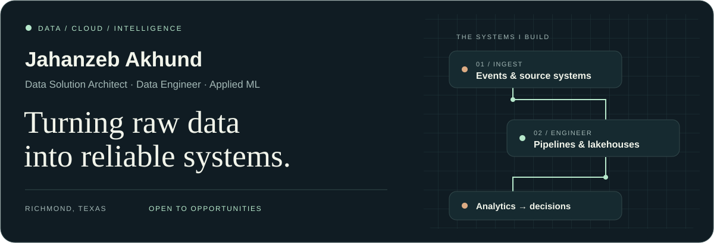
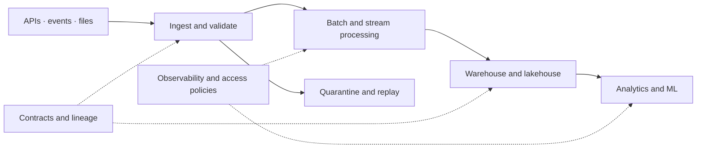

<picture>
  <source media="(prefers-color-scheme: dark)" srcset="assets/hero-dark.svg">
  <source media="(prefers-color-scheme: light)" srcset="assets/hero-light.svg">
  
</picture>

  
  
  
  

I design data platforms that turn fragmented source systems into dependable analytics and useful ML applications. My focus spans **cloud data architecture, batch and streaming pipelines, warehousing, healthcare data integration, and governance**.

I care about the details that keep a system understandable and recoverable: explicit data contracts, correct reporting grain, source-version rules, observable failures, and a clear path to replay.

## Selected work

**Start with the architecture. Follow the data. Inspect the evidence.**

<table>
<tr>
<td width="50%" valign="top">

01 / STREAMING

<h3><a href="https://github.com/jahanzebakhund795-alt/kafka-supply-chain-control-tower">Supply chain control tower ↗</a></h3>

Versioned shipment events, transactional SQL writes, replay handling, and a query API.

<code>Kafka</code> · <code>PostgreSQL</code> · <code>FastAPI</code>

<a href="https://github.com/jahanzebakhund795-alt/kafka-supply-chain-control-tower/blob/main/README.md">Overview</a> · <a href="https://github.com/jahanzebakhund795-alt/kafka-supply-chain-control-tower/blob/main/docs/ARCHITECTURE.md">Architecture</a> · <a href="https://github.com/jahanzebakhund795-alt/kafka-supply-chain-control-tower/blob/main/VALIDATION.md">Validation</a>

</td><td width="50%" valign="top">

02 / LAKEHOUSE

<h3><a href="https://github.com/jahanzebakhund795-alt/spark-delta-cdc-lakehouse">A lakehouse built for change ↗</a></h3>

Bronze-to-gold CDC processing, conflict checks, conditional merges, and durable deletion tombstones.

<code>PySpark</code> · <code>Delta Lake</code> · <code>CDC</code>

<a href="https://github.com/jahanzebakhund795-alt/spark-delta-cdc-lakehouse/blob/main/README.md">Overview</a> · <a href="https://github.com/jahanzebakhund795-alt/spark-delta-cdc-lakehouse/blob/main/docs/ARCHITECTURE.md">Architecture</a> · <a href="https://github.com/jahanzebakhund795-alt/spark-delta-cdc-lakehouse/blob/main/VALIDATION.md">Validation</a>

</td>
</tr>
<tr>
<td width="50%" valign="top">

03 / ORCHESTRATION

<h3><a href="https://github.com/jahanzebakhund795-alt/airflow-multisource-data-platform">From source APIs to warehouse ↗</a></h3>

Paginated ingestion, atomic staging, source checkpoints, and recoverable transactional loads.

<code>Airflow</code> · <code>Python</code> · <code>ETL</code>

<a href="https://github.com/jahanzebakhund795-alt/airflow-multisource-data-platform/blob/main/README.md">Overview</a> · <a href="https://github.com/jahanzebakhund795-alt/airflow-multisource-data-platform/blob/main/docs/ARCHITECTURE.md">Architecture</a> · <a href="https://github.com/jahanzebakhund795-alt/airflow-multisource-data-platform/blob/main/VALIDATION.md">Validation</a>

</td><td width="50%" valign="top">

04 / ANALYTICS

<h3><a href="https://github.com/jahanzebakhund795-alt/dbt-insurance-finance-warehouse">Insurance finance warehouse ↗</a></h3>

Dimensional models, incremental claim facts, policy-history snapshots, and tested financial grain.

<code>dbt</code> · <code>DuckDB</code> · <code>SQL</code>

<a href="https://github.com/jahanzebakhund795-alt/dbt-insurance-finance-warehouse/blob/main/README.md">Overview</a> · <a href="https://github.com/jahanzebakhund795-alt/dbt-insurance-finance-warehouse/blob/main/docs/ARCHITECTURE.md">Architecture</a> · <a href="https://github.com/jahanzebakhund795-alt/dbt-insurance-finance-warehouse/blob/main/VALIDATION.md">Validation</a>

</td>
</tr>
<tr>
<td width="50%" valign="top">

05 / GOVERNANCE

<h3><a href="https://github.com/jahanzebakhund795-alt/openlineage-governance-control-plane">Know your data’s dependencies ↗</a></h3>

Dataset and column lineage, downstream impact analysis, role-based projection, and masking policies.

<code>OpenLineage</code> · <code>FastAPI</code> · <code>Governance</code>

<a href="https://github.com/jahanzebakhund795-alt/openlineage-governance-control-plane/blob/main/README.md">Overview</a> · <a href="https://github.com/jahanzebakhund795-alt/openlineage-governance-control-plane/blob/main/docs/ARCHITECTURE.md">Architecture</a> · <a href="https://github.com/jahanzebakhund795-alt/openlineage-governance-control-plane/blob/main/VALIDATION.md">Validation</a>

</td><td width="50%" valign="top">

06 / HEALTHCARE

<h3><a href="https://github.com/jahanzebakhund795-alt/beam-member-payment-reconciliation">Reconcile member-month feeds ↗</a></h3>

Distributed outer joins, validation, cardinality checks, and separate accepted and exception outputs.

<code>Apache Beam</code> · <code>Dataflow-ready</code> · <code>Reconciliation</code>

<a href="https://github.com/jahanzebakhund795-alt/beam-member-payment-reconciliation/blob/main/README.md">Overview</a> · <a href="https://github.com/jahanzebakhund795-alt/beam-member-payment-reconciliation/blob/main/docs/ARCHITECTURE.md">Architecture</a> · <a href="https://github.com/jahanzebakhund795-alt/beam-member-payment-reconciliation/blob/main/VALIDATION.md">Validation</a>

</td>
</tr>
</table>

<strong>What was actually validated?</strong>

The ten platform implementations include **29 passing Python tests**. The dbt warehouse also passed **19 data-quality checks** on two full pipeline runs, and the Beam reconciliation pipeline passed its **DirectRunner output assertions**.

Each repository records its own executed checks and deployment limits in `VALIDATION.md`. Kafka/PostgreSQL, Spark/Delta, Airflow, and container runtime checks require their documented integration environments. Portfolio examples use synthetic data and are independent of employer systems.

## Project directory

Choose a track and expand it. The platform implementations, applied ML explorations, and focused engineering labs serve different purposes.

<strong>Data platforms, orchestration & governance</strong> — click to explore

| Repository | Explore |
| :--- | :--- |
| [kafka-supply-chain-control-tower](https://github.com/jahanzebakhund795-alt/kafka-supply-chain-control-tower) | Streaming events → idempotent SQL sink → query API |
| [spark-delta-cdc-lakehouse](https://github.com/jahanzebakhund795-alt/spark-delta-cdc-lakehouse) | Delta bronze/silver/gold layers with version-aware CDC |
| [airflow-multisource-data-platform](https://github.com/jahanzebakhund795-alt/airflow-multisource-data-platform) | Recoverable multisource ETL with durable checkpoints |
| [dbt-insurance-finance-warehouse](https://github.com/jahanzebakhund795-alt/dbt-insurance-finance-warehouse) | Dimensional modeling, snapshots, and loss-ratio marts |
| [beam-member-payment-reconciliation](https://github.com/jahanzebakhund795-alt/beam-member-payment-reconciliation) | Member-month feed reconciliation with Beam |
| [data-contract-registry-service](https://github.com/jahanzebakhund795-alt/data-contract-registry-service) | Versioned schemas, compatibility gates, and payload validation |
| [cross-warehouse-migration-auditor](https://github.com/jahanzebakhund795-alt/cross-warehouse-migration-auditor) | Cursor-based comparisons, canonical values, and discrepancy reports |
| [data-pipeline-observability-platform](https://github.com/jahanzebakhund795-alt/data-pipeline-observability-platform) | Pipeline SLOs, freshness, burn rates, and Prometheus export |
| [openlineage-governance-control-plane](https://github.com/jahanzebakhund795-alt/openlineage-governance-control-plane) | Lineage, impact analysis, and role-controlled field policies |
| [enterprise-data-vault-platform](https://github.com/jahanzebakhund795-alt/enterprise-data-vault-platform) | Transactional hubs, links, satellites, and as-of history |

<strong>Applied AI, ML & healthcare</strong> — click to explore

| Repository | Explore |
| :--- | :--- |
| [healthcare-claims-lakehouse](https://github.com/jahanzebakhund795-alt/healthcare-claims-lakehouse) | Healthcare claims processing and warehouse exploration |
| [mlops-demand-forecasting](https://github.com/jahanzebakhund795-alt/mlops-demand-forecasting) | Demand forecasting, backtesting, and model-lifecycle exploration |
| [realtime-fraud-detection](https://github.com/jahanzebakhund795-alt/realtime-fraud-detection) | Streaming fraud and anomaly-detection exploration |
| [personalization-recommender](https://github.com/jahanzebakhund795-alt/personalization-recommender) | Candidate generation, ranking, and recommendation evaluation |
| [clinical-rag-assistant](https://github.com/jahanzebakhund795-alt/clinical-rag-assistant) | Clinical retrieval and grounded-answer exploration |
| [readmission-risk-xgboost](https://github.com/jahanzebakhund795-alt/-readmission-risk-xgboost) | Readmission-risk modeling and explainability exploration |

<strong>Focused data engineering labs</strong> — click to explore

| Repository | Explore |
| :--- | :--- |
| [incremental-orders-etl](https://github.com/jahanzebakhund795-alt/incremental-orders-etl) | Idempotent loads and source-version handling |
| [event-time-stream-processor](https://github.com/jahanzebakhund795-alt/event-time-stream-processor) | Windows, late events, and deduplication |
| [retail-star-schema](https://github.com/jahanzebakhund795-alt/retail-star-schema) | Fact grain, dimensions, and reporting joins |
| [scd-type2-customer-history](https://github.com/jahanzebakhund795-alt/scd-type2-customer-history) | Temporal dimensions and as-of lookups |
| [data-vault-order-model](https://github.com/jahanzebakhund795-alt/data-vault-order-model) | Business keys, links, and hash differences |
| [medallion-lakehouse-pipeline](https://github.com/jahanzebakhund795-alt/medallion-lakehouse-pipeline) | Layered validation, deduplication, and aggregates |
| [data-quality-gate](https://github.com/jahanzebakhund795-alt/data-quality-gate) | Completeness, uniqueness, and range checks |
| [data-contract-compatibility](https://github.com/jahanzebakhund795-alt/data-contract-compatibility) | Schema-evolution rules and compatibility checks |
| [sensitive-data-tokenizer](https://github.com/jahanzebakhund795-alt/sensitive-data-tokenizer) | Allowlist projection and keyed pseudonyms |
| [column-lineage-impact](https://github.com/jahanzebakhund795-alt/column-lineage-impact) | Dependency graphs and impact traversal |

[Browse all repositories ↗](https://github.com/jahanzebakhund795-alt?tab=repositories)

## How I approach a platform

<strong>Explore the architecture behind the work</strong>

- **Define the contract:** keys, grain, source versions, ownership, and quality rules.
- **Make recovery deliberate:** commit checkpoints with sink state and retain replayable inputs.
- **Keep history useful:** model change explicitly with temporal dimensions, CDC, or satellites.
- **Measure what matters:** freshness, data quality, latency, and the impact of failed runs.
- **Design for the domain:** handle healthcare data and sensitive fields with explicit access policies.

## Toolbox

| Data & compute | Cloud & architecture | Reliability & delivery |
| :--- | :--- | :--- |
| Python · SQL · PySpark · Scala | AWS · Azure · GCP | Docker · Kubernetes · Terraform |
| Kafka · Spark · Apache Beam | Databricks · Snowflake · Delta Lake | Airflow · dbt · CI/CD |
| PostgreSQL · SQL Server · DuckDB | Lakehouse · dimensional modeling · Data Vault | Data contracts · lineage · observability |

<strong>Explore additional tools and domain experience</strong>

**ETL and integration:** Talend, Apache NiFi, Informatica, SSIS, flat files, REST APIs, structured and semi-structured data.

**Applied ML and analytics:** scikit-learn, TensorFlow, PyTorch, MLflow, feature engineering, model evaluation, Tableau, Power BI, QuickSight, and Plotly.

**Healthcare and governance:** EHR and claims data, HL7, clinical integration, metadata management, data quality, sensitive-field controls, and privacy-aware architecture.

Tool choices depend on the workload. Repository documentation distinguishes the integrations implemented in code from deployment adaptations and future work.

## Let’s connect

Interested in **data architecture, senior data engineering, or cloud data platform opportunities**. Based in **Richmond, Texas**.

  
  

[jahanzebakhund795@gmail.com](mailto:jahanzebakhund795@gmail.com) · [LinkedIn](https://www.linkedin.com/in/jahanzeb-akhund) · [Back to top ↑](#top)
